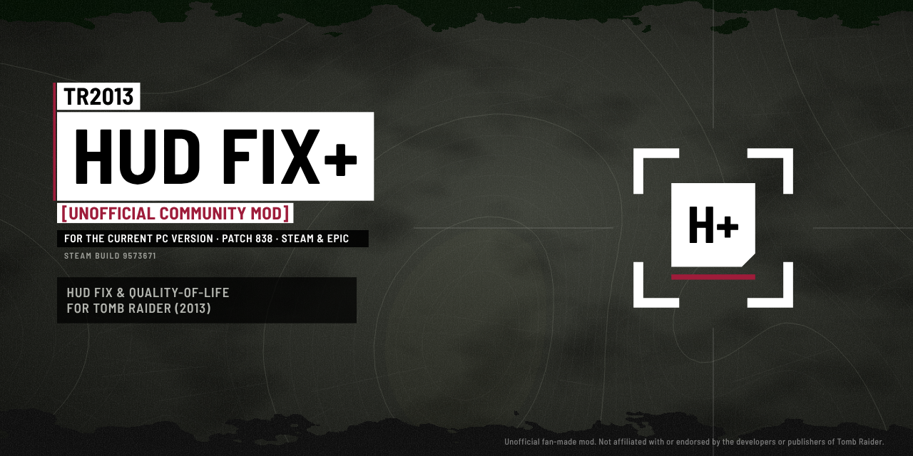
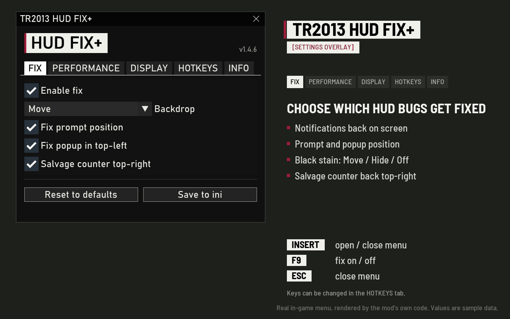
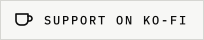

# TR2013 HUD Fix+



Unofficial, multiplayer-safe community fix for HUD bugs in **Tomb Raider (2013) / GOTY** on PC (current build, Steam and Epic). It is not affiliated with Crystal Dynamics or Square Enix.

Before this fix, the only workaround was to downgrade to Steam build 743, and that is not possible on Epic.

Current version: **1.4.6**

## Supported game version

**Tomb Raider (2013) / GOTY, current PC version: Patch 838, Steam build 9573671 (27 Sep 2022).** Tested on Steam.

| Version | Status |
|---|---|
| Steam, public branch (Patch 838, build 9573671) | Tested |
| Epic Games Store | Same version and bugs, should work (not tested) |
| GOG | Not tested. If GOG has the same game version, it should work. Feedback welcome! If the bottom-right notifications end up in the wrong place, press F9 to turn the fix off. |
| Microsoft Store / Xbox app / Game Pass (*Definitive Edition*) | Not tested and probably not supported: the Definitive Edition is a separate port with different shaders, so the fix most likely does nothing there. Feedback welcome. |
| Patch 829 (Oct 2021) / 838 (Nov 2021) before the Sep 2022 auth fix | Same HUD behaviour, should work |
| Steam beta branch `build743.0` | Not affected, fix not needed |

Quick check: if `EOSSDK-Win32-Shipping.dll` is in your game folder, you have an affected version. The launcher shows `v1.01.0.0` for all builds, so it cannot tell them apart.

Version history (from the official Steam patch notes): Patch 829.0 (18 Oct 2021) added Epic Online Services; Patch 838 (18 Nov 2021) re-released it and moved the old version to the beta branch `build743.0`; the 27 Sep 2022 update (build 9573671) only fixed the online authentication (`EOSSDK-Win32-Shipping.dll`, `TombRaider.exe` −528 bytes), so the HUD behaviour is unchanged since 838.

## Fixed bugs

Fixes are applied during gameplay only; menus are never modified.

1. **Off-screen notifications.** Notifications at the bottom right (weapon upgrade, skill point, "find a base camp", tomb and map popups, ...) are pushed partly off-screen.
2. **Popups and prompts at the origin.** Notifications and interaction prompts ("PRESS [E] ...") are sometimes drawn at the HUD origin in the top-left corner. They are moved back to their original place.
3. **Black stain.** When you pick up ammo or salvage, the background of the pickup notification is sometimes drawn at the wrong position and shows up as a dark stain at the top of the screen.
4. **Salvage counter.** The salvage counter is shown in the top-left corner without its "SALVAGE" label. It is moved back to its original top-right position (pre-2021 layout; can be disabled in the menu).

## Extras



- **In-game menu** (Dear ImGui, **INSERT**): adjust all settings live and save them to `tr_hud_fix.ini`.
- **Quick toggle:** **F9** switches the fix on or off for comparison.
- **FPS limiter and FPS overlay**, with frame time statistics and a graph.
- **Borderless window and flip model** (experimental, need a game restart).
- **Low-memory warning:** the game is a 32-bit program (about 4 GB of address space). When it runs low, a notice asks you to save and restart; the PERFORMANCE tab shows an address space bar. `[Memory]` in `tr_hud_fix.ini`.
- **Hotkey rebinding** in the menu or in `tr_hud_fix.ini`, as key names (`F9`, `INSERT`, `PAGE UP`, `NUM 5`, ...) or virtual-key codes (`MenuHotkey=0` disables the menu completely).
- **Advanced sliders** for the bottom-right notification offset/scale are hidden by default (the values are calibrated); `ShowAdvanced=1` in `[Menu]` shows them.

## Install

1. Download the release zip.
2. Open the game folder (the folder containing `TombRaider.exe`).
   - Steam: right-click the game > Manage > Browse local files.
   - Epic: Library > ... > Manage > Installation folder.
3. Copy `d3d11.dll` and `tr_hud_fix.ini` into that folder and start the game.

That's it: **the fix is active right away, all corrections are on by default.** No setup is needed; the settings menu (**INSERT**) is optional, and **F9** turns the fix off and on for comparison.

To use it together with DXVK or another `d3d11.dll`, rename the existing file to `d3d11_orig.dll` (or `dxvk_d3d11.dll` for DXVK) before copying, or set `ProxyDll=<file name>` in `tr_hud_fix.ini`. The fix then loads it automatically (chain loading).

**ReShade:** install ReShade as `dxgi.dll` (the default for Direct3D 10/11/12) and keep that name. Do not rename it to `d3d11_orig.dll` or load it via `ProxyDll`, the game will not start. See [Known issues](#known-issues).

### Linux / Steam Deck (Proton)

Not tested yet - feedback welcome. Use the same zip (the fix runs inside the Windows version of the game):

1. Copy `d3d11.dll` and `tr_hud_fix.ini` into the game folder as above.
2. In Steam: game > Properties > General > Launch options:
   `WINEDLLOVERRIDES="d3d11=n,b" %command%`
   (otherwise Proton ignores the `d3d11.dll` in the game folder).

The native Linux version of the game (OpenGL) is not supported. To use the fix, force Proton under Properties > Compatibility.

See [README.txt](README.txt) for details (English and German).

## Uninstall

Delete `d3d11.dll` and `tr_hud_fix.ini` from the game folder.

## Compatibility

| Status | Setups |
|---|---|
| Tested | Steam version; 16:9 (2560x1440, 1920x1080, 1280x720), 16:10 (1680x1050), 5:4 (1280x1024), 4:3 (1024x768, 800x600); exclusive fullscreen; Steam overlay. Test system: Windows 11 26H2, AMD Radeon RX 9070 XT (driver 26.11.1) |
| Should work (untested) | Epic and GOG version; NVIDIA / Intel GPUs; Windows 10; ultrawide 21:9 / 32:9; DXVK via chain loading (`d3d11_orig.dll` or `ProxyDll=`); common overlays |
| Known issues | ReShade (as `dxgi.dll`); some systems where the HUD corrections do not apply, see [Known issues](#known-issues) |
| Untested, feedback welcome | Linux / Steam Deck via Proton (launch option `WINEDLLOVERRIDES="d3d11=n,b" %command%`, see [Install](#install)) |
| Not supported | Native Linux version (OpenGL); Microsoft Store / Game Pass *Definitive Edition* (separate port) |
| Not recommended | Special K (it hooks Direct3D 11 itself and may conflict) |
| ASI loaders | Do not work with this game: `TombRaider.exe` loads `version.dll`, `winmm.dll` and `dinput8.dll` from System32. Use `d3d11.dll`. |

If a future game update changes the HUD shaders, the fix simply does nothing (no crash).

## Known issues

A test build with fixes and extra diagnostics is available: [v1.4.7-beta1](https://github.com/mythenstudios/TR2013-HUD-Fix-Plus/releases/tag/v1.4.7-beta1).

**HUD corrections do not apply on some systems**
- On some systems the game places the HUD at a slightly different internal value, so the fix does not recognize it. The menu (INSERT), the FPS limiter and the other features still work.
- An automatic detection is planned for the next version.
- If this affects you, please post your `tr_hud_fix.log` (see [Diagnostics](#diagnostics)).

**ReShade**
- With ReShade installed as `dxgi.dll`, the game runs, but the HUD corrections may not apply. This is being investigated.
- Renaming ReShade to `d3d11_orig.dll` or loading it via `ProxyDll` does not work, the game does not start. Chain loading is meant for DXVK; keep ReShade as `dxgi.dll`.

**Startup crash on some Windows 10 systems (1.4.6)**
- Fixed in the test build v1.4.7-beta1.
- With 1.4.6, ticking "Disable fullscreen optimizations" for `TombRaider.exe` (Properties > Compatibility) can help.

## How it works

`d3d11.dll` is a DirectX 11 proxy. It forwards to the system `d3d11.dll` (or a chained one) and hooks a few `ID3D11DeviceContext` functions. It recognises the affected HUD draws by their shader bytecode hashes. For those draws only, it binds a corrected copy of the HUD transform constant buffer. That copy lives in the fix's own dynamic buffer, so the game's memory is never written.

`TombRaider.exe`, `steam_api.dll` and `EOSSDK-Win32-Shipping.dll` are never modified or patched, and no game files are changed.

## Build

Requirements:
- Visual Studio 2019 or 2022 (Build Tools are enough) with the MSVC x86/x64 toolset.
- No other dependencies. Dear ImGui 1.93.0 is vendored in `third_party/imgui`.

```bat
build.bat            :: builds build\d3d11.dll, 32-bit, /MT
build.bat release    :: builds and creates release\TR2013_HUD_Fix_Plus\ + zip (logging off)
build.bat deploy     :: builds and copies d3d11.dll + tr_hud_fix.ini to the game folder
```

`deploy` needs the game folder in `TR_GAME_DIR` (environment variable) or in a local, git-ignored `build.local.cmd` file:

```bat
set "TR_GAME_DIR=C:\path\to\Tomb Raider"
```

The `deploy` step never overwrites a foreign `d3d11.dll` (for example DXVK or ReShade).

## Diagnostics

Logging is off by default (`EnableLogging=0`: no log file and no diagnostic work).

- **`EnableLogging=2` (recommended for bug reports):** watchdog mode. It writes a small `tr_hud_fix.log` to the game folder that records off-screen HUD elements, crashes, memory usage (`[MEM]`) and the HUD elements seen (`[INV]`). The log of the previous start is kept as `tr_hud_fix.prev.log`. After a crash, please send that file.
- **`EnableLogging=1`:** full analysis log. In modes 1 and 2, **F10** records 3 complete frames: every draw call, its shaders, constant-buffer contents and the decoded vertex bounds. This is how the bugs were located.

The log size is limited by `MaxLogMB` (default 50 MB).

**Crash report (always on):** if the game crashes, the fix writes `tr_hud_fix_crash.txt` to the game folder (with logging on, the report goes into `tr_hud_fix.log`). It records where the crash happened, the caller, the address space state and the last display events. Please attach it to crash reports.

**Game crashes without the fix too.** Tomb Raider (2013) has crashed now and then since release. The most common remedy is to turn off Tessellation; if needed, also TressFX or reduce SSAA.

## License

- TR2013 HUD Fix+: MIT, see [LICENSE](LICENSE).
- Dear ImGui: MIT, © Omar Cornut, see `third_party/imgui/LICENSE.txt`.

---

The fix is and stays free. If it helped you, a coffee helps me keep building. Thank you!

<a href="https://ko-fi.com/mythenstudios">
  <picture>
    <source media="(prefers-color-scheme: dark)" srcset="branding/graphics/kofi-dark.svg">
    
  </picture>
</a>
